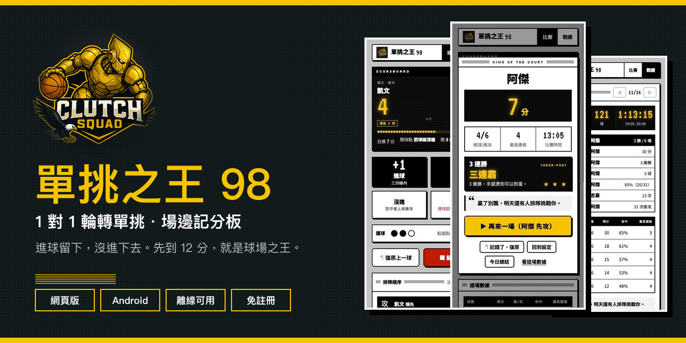
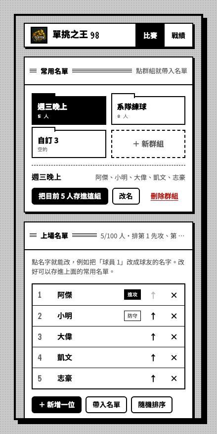
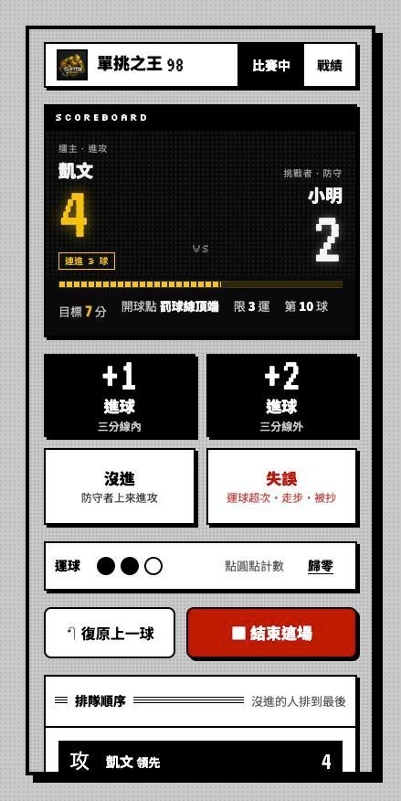
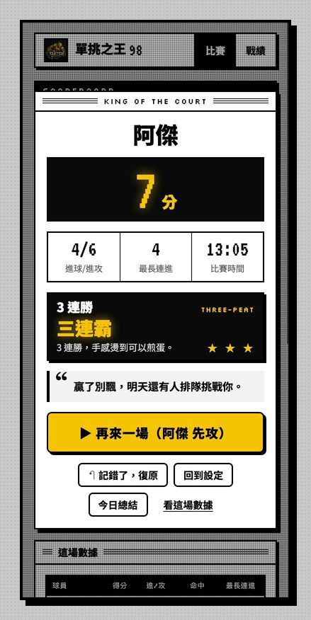
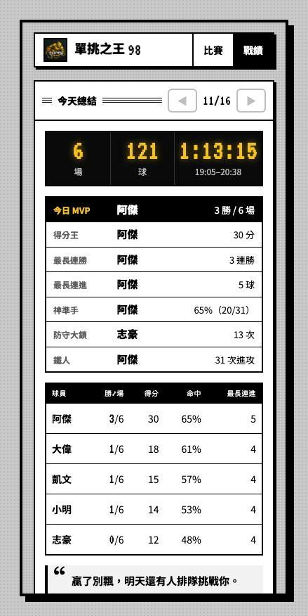

<p align="center">
  
</p>

<h3 align="center">進球留下，沒進下去。先到 12 分，就是球場之王。</h3>

<p align="center">
  <a href="https://jjptt1980.github.io/king-of-the-court-98/"><b>▶ 立刻開打（網頁版）</b></a>
  &nbsp;·&nbsp;
  <a href="https://github.com/JJptt1980/king-of-the-court-98/releases/latest"><b>⬇ 下載 Android APK</b></a>
</p>

---

## 別再原地拍球了

美國訓練營最愛的單挑玩法叫 **King of the Court**：一個人攻、一個人守，其他人排隊。進球就留在場上，沒進就換人。再加上一條狠規則：**最多只能運 3 下**。

於是你沒時間晃，只能在接球的那一秒判斷：投、切，還是用假動作騙開一步。三重威脅、第一步、急停跳投，全部被逼出來。

好玩的是比賽，麻煩的是記分。誰幾分？輪到誰？剛剛那球算不算？

**單挑之王 98** 把這些都交給手機。你只管打球，場邊的人按一下按鈕就好。

## 規則，一分鐘看懂

1. 排第 1 的人進攻，排第 2 的人防守，其他人排隊。
2. 進攻者最多運球 3 次，就得出手。
3. **進球**：加分，繼續留在場上進攻。剛剛的防守者排到隊伍最後，下一位上來守。
4. **沒進或失誤**：進攻者排到隊伍最後，防守者升上來進攻。
5. 先拿到目標分數（預設 12 分）的人贏。

目標分數、計分方式、運球上限都可以改。

## 一支手機，搞定整場

<table>
  <tr>
    <td align="center" width="25%"></td>
    <td align="center" width="25%"></td>
    <td align="center" width="25%"></td>
    <td align="center" width="25%"></td>
  </tr>
  <tr>
    <td valign="top"><b>名單一點就帶入</b><br>常用名單存成群組，自己取名。貼上一串名字也能一次帶入，最多 100 人。</td>
    <td valign="top"><b>大按鈕，單手盲按</b><br>金色 LED 記分板，場邊遠遠也看得到。運球計數、開球點提示、語音報分都有。</td>
    <td valign="top"><b>贏了要有儀式感</b><br>每場勝利送一句鼓勵。連勝會解鎖稱號：熱手、三連霸、主宰，一路到傳奇。</td>
    <td valign="top"><b>打完看今日總結</b><br>MVP、得分王、最長連勝、神準手、防守大鎖。一鍵複製，直接貼到 LINE 群組。</td>
  </tr>
</table>

### 完整功能

- **自動輪替**：進攻、防守、排隊順序全自動，不會再吵「輪到誰」。
- **規則隨你調**：目標 7／11／12／15 分或自訂；3 分線內 1 分、線外 2 分，或全都 1 分；限 1／2／3 運或不限；失誤可以選擇扣分。
- **開球點輪替**：罰球線頂端、左右肘區，或弧頂、左右 45° 輪流開球，每個角度都練到。
- **運球計數**：點一下記一運，到上限喊「收！」。
- **語音報分**：每球報「誰幾分、誰防守、在哪開球」，場上的人不用回頭看螢幕。
- **按錯可以復原**：連最後致勝的那一球都能退回。
- **連勝獎勵**：熱手（2 連勝）、三連霸（3）、主宰（4）、球場之王（5）、傳奇（7 以上）。單場連進 5 球、全部命中、完封對手也有獎勵。
- **戰績與排行榜**：每場數據、累積勝率、命中率、最長連進、防守成功次數。
- **每球紀錄匯出**：匯出成 CSV，貼進 Excel 或 Google 試算表做分析。
- **離線也能用**：球場沒訊號照樣記分。Android 版比賽時螢幕保持常亮。

## 為什麼叫 98？

因為我們想念那個年代：黑白視窗、條紋標題列、LED 計分板。沒有多餘的漸層和動畫，只留下比賽需要的資訊。

整個介面只有一個地方有顏色，就是記分板上那排金色數字。因為場上最重要的，就是比分。

## 開始使用

**手機瀏覽器（iPhone、Android 都可以）**

1. 打開 [jjptt1980.github.io/king-of-the-court-98](https://jjptt1980.github.io/king-of-the-court-98/)。
2. 從瀏覽器選單選「加到主畫面」。
3. 之後就像 App 一樣從桌面打開，沒網路也能用。

**Android App**

1. 到 [Releases](https://github.com/JJptt1980/king-of-the-court-98/releases/latest) 下載 `.apk` 檔。
2. 安裝時允許「安裝未知來源的應用程式」。目前是測試版簽章，手機跳出警告是正常的。

## 你的資料留在你的手機

不用註冊，不用登入，沒有廣告。所有名單和戰績都只存在你自己的裝置上，不會上傳到任何伺服器。

換手機或清除瀏覽器資料時，紀錄會跟著消失。重要的戰績記得先用「匯出」或「複製總結」備份。

## 開發

需要 Node.js 22 以上。打包 Android 還需要 JDK 21 和 Android SDK（裝 Android Studio 即可）。

```bash
npm install
npm run build:web     # 產生 www/（網頁版）
npm run serve         # 在 http://localhost:5178 預覽
npm run build:apk     # 產生 android/app/build/outputs/apk/debug/app-debug.apk
```

整個 app 的畫面與邏輯都在 `src/app.html`。`build-web.mjs` 會把它包成可離線的網頁版（加上 manifest 和 service worker），Android 版用 [Capacitor](https://capacitorjs.com/) 包裝同一份網頁。

推送到 `main` 分支後，GitHub Actions 會自動把網頁版部署到 GitHub Pages。

換隊徽時，把新圖放到 `assets/logo.png`，再執行 `node scripts/make-emblem.mjs` 產生所有圖示。README 的插圖由 `node scripts/make-readme-images.mjs` 從 `docs/raw/` 的截圖產生。

### 專案結構

```
src/app.html            畫面與邏輯（單一檔案，90 年代極簡風）
src/app-classic.html    舊版介面（保留參考）
build-web.mjs           產生 www/ 網頁版
android-assets.mjs      產生 Android 圖示與啟動畫面
assets/logo.png         CLUTCH SQUAD 隊徽（所有圖示由此產生）
docs/                   README 插圖與原始截圖
scripts/                圖示、插圖產生工具
android/                Capacitor Android 專案
.github/workflows/      GitHub Pages 自動部署
```

## 授權

[MIT License](LICENSE)。可以自由使用、修改、散布，只要保留版權聲明。

<p align="center"><sub>Made for CLUTCH SQUAD・下一球，換你上。</sub></p>
